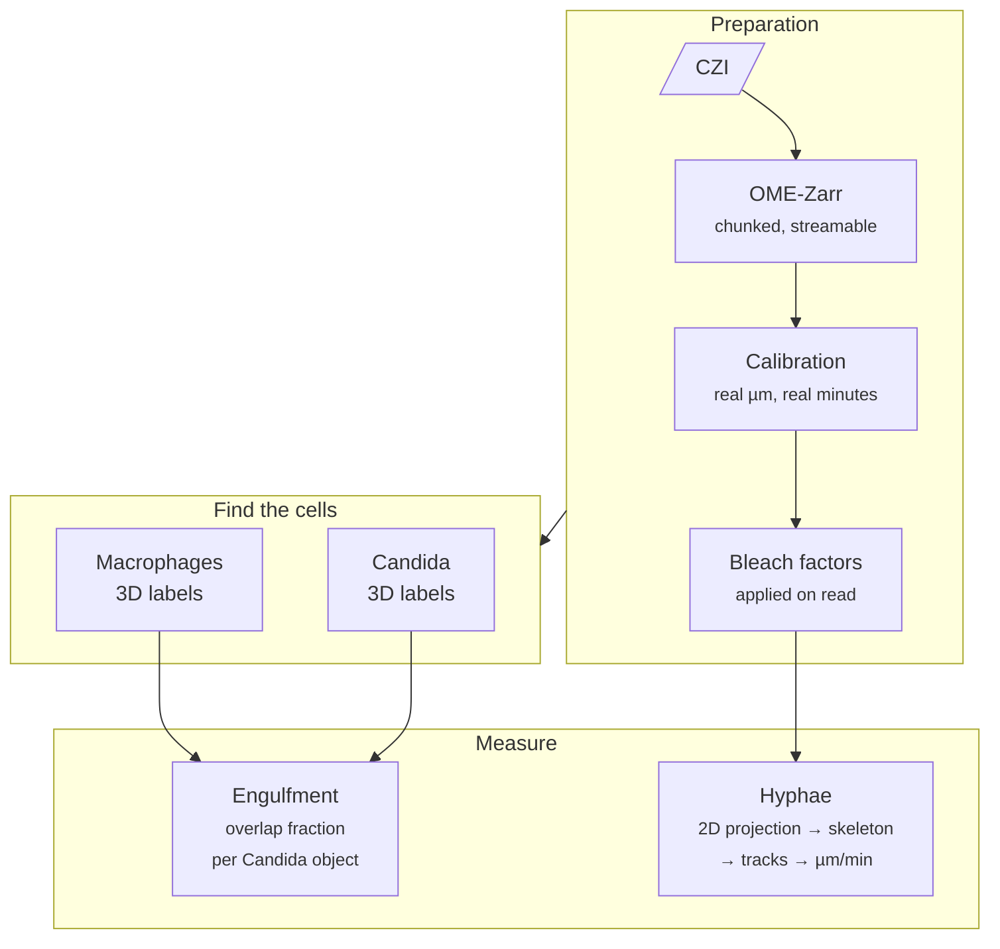

# How it works

This page explains the method in plain terms: what is in the movie, what the pipeline
measures, and why it is built the way it is. You don't need to read code to follow it.

## The experiment

A **lattice light-sheet microscope** records a 3D image stack of living cells every few
minutes for hours. The reference movies have:

| | |
|---|---|
| Timepoints | 120 (~3 minutes apart, ≈6 hours) |
| Volume per timepoint | 301 × ~400 × ~370 voxels |
| Voxel size | 0.145 µm, the same in x, y and z (*isotropic*) |
| Channels | *Candida* (red), macrophages (green), lysed-cell marker (magenta, ignored) |
| Size on disk | ~30 GB per movie |

Two things happen in these movies that we want to measure:

1. **Macrophages engulf *Candida*.** A yeast cell or hypha ends up partly or fully inside a
   macrophage.
2. **_Candida_ grows hyphae.** Filaments extend and branch, sometimes through or out of the
   macrophages that took them up.

## From pixels to measurements

### 1. Make the data streamable

Zeiss CZI files are a single proprietary block. They are converted to **OME-Zarr**, an open
format that stores the movie as many small chunks. Any single timepoint can then be read
without loading the whole 30 GB file. Every later step works **one timepoint at a time**.

### 2. Put real units on everything

The pipeline reads the voxel size and the **actual** acquisition time of every frame from
the microscope metadata. It never assumes "3 minutes per frame", because real intervals
drift. Every rate it reports (µm/min) uses these real timestamps.

### 3. Correct for photobleaching, carefully

Fluorescence fades as it is imaged, so a cell can look dimmer late in the movie just because
it has been imaged many times. Left uncorrected, that fading can look like biology (for
example, a pathogen "dying").

The pipeline measures how the brightness of the **cells** (not the background) changes over
time and stores a correction factor for each frame. The raw data is never modified; the
correction is applied as each frame is read.

!!! example "Why not correct every channel?"
    In the reference data the macrophage signal fades (bleaching), but the *Candida* signal
    **rises** because there is more fungus as it grows. "Correcting" that would erase the
    growth. So macrophages are corrected and *Candida* is not. You need to make this call for
    your own data. [See Stage 3](../pipeline/03-calibration.md#should-a-channel-be-corrected).

### 4. Find individual cells in 3D

**Cellpose-SAM**, a deep-learning segmentation model, outlines every cell in 3D and gives
each one a unique number (a *label*). This runs on a GPU, one SLURM job per timepoint.

A simple brightness threshold would merge cells that touch. Cellpose separates them.

### 5. Measure engulfment as 3D overlap

For each *Candida* object the pipeline asks: *what fraction of its volume lies inside a
macrophage?* It takes the best-overlapping macrophage and sorts the object into one of
three classes:

| Inside the macrophage | Class | Interpretation |
|---|---|---|
| ≥ 90 % | `engulfed` | Essentially fully internalised |
| 5 – 90 % | `partial` | A phagocytic cup, or a hypha threading through |
| < 5 % | `free` | Not associated |

Both thresholds can be changed. This is a **single-frame** test: an object passing briefly
in front of a macrophage can score as `partial` for one frame. Checking that the overlap
**persists** across frames is planned but not built yet.

### 6. Measure hyphae as networks, not blobs

Hyphae are long, thin and branched, a shape instance segmenters handle badly. Instead, the
pipeline:

1. projects each 3D frame to 2D (**maximum-intensity projection**),
2. segments the projection,
3. reduces each object to a one-pixel-wide **skeleton**,
4. treats the skeleton as a **graph** and counts length, tips (growing ends) and branch
   points, and
5. links objects across frames by **overlap** to follow each hypha over time.

Projection to 2D is cheap and standard, but filaments that cross in depth merge in the
projection, so lengths are a **lower bound** on the true 3D length.

### 7. Look at it

Every number comes with a way to see where it came from: QC images on disk, napari viewers
that overlay labels on the raw data, and review notebooks. The pipeline labels its outputs
**PROPOSED** until a person has checked them.

---

**Read next:** [Design principles](design.md), the engineering decisions that make this
safe to run on a shared cluster.
