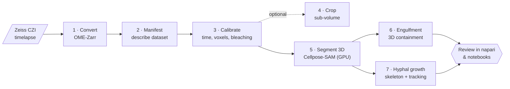

---
hide:
  - navigation
  - toc
---

# macro_candi

Turn live 3D lattice light-sheet movies of <em>Candida</em> meeting macrophages into
numbers you can check: who got engulfed, when, and how fast the hyphae grew.

[Try the 2-minute demo :material-play:](getting-started/demo.md){ .md-button .md-button--primary }
[Get started](getting-started/index.md){ .md-button }
[How it works](concepts/index.md){ .md-button }
[View on GitHub :fontawesome-brands-github:](https://github.com/JurgenKriel/macro_candi){ .md-button }

!!! warning "Research code: every number is *proposed*"
    Every measurement the pipeline writes is labelled **PROPOSED**. Confirm it by eye with the
    included napari viewers and review notebooks before you treat it as a result. See
    [Known limitations](help/limitations.md) for how far each output can currently be trusted.

## What it does

-   :material-bacteria-outline:{ .lg .middle } **Engulfment and entrapment**

    ---

    For every *Candida* object in every frame, the fraction of it that sits inside each
    macrophage, classified as `engulfed`, `partial` (phagocytic cup) or `free`.

    [:octicons-arrow-right-24: Stage 6](pipeline/06-engulfment.md)

-   :material-graph-outline:{ .lg .middle } **Hyphal network growth**

    ---

    Skeleton-graph metrics per object (length, tips, branch points), tracked across frames
    to give elongation rates in µm/min on the real time axis.

    [:octicons-arrow-right-24: Stage 7](pipeline/07-hyphae.md)

-   :material-server-network:{ .lg .middle } **Built for HPC clusters**

    ---

    Runs on Linux + SLURM with one GPU job per timepoint. Re-submitting any stage is safe:
    finished work is skipped, and a killed job never leaves a half-written file behind.

    [:octicons-arrow-right-24: Design principles](concepts/design.md)

-   :material-eye-check-outline:{ .lg .middle } **Built to be checked**

    ---

    napari viewers and Jupyter review notebooks for every stage, plus QC images on disk, so
    you can see what each number came from.

    [:octicons-arrow-right-24: Review & QC](review.md)

## Is this for me?

You will get the most out of macro_candi if:

- [x] you have **single-scene, non-mosaic CZI timelapses** of a pathogen channel and a host-cell channel;
- [x] you have access to a **Linux cluster with SLURM** and an **NVIDIA GPU with at least 16 GB** of memory;
- [x] you are comfortable running commands in a terminal and editing a YAML file.

!!! tip "No data or GPU yet?"
    `pixi run demo` generates a synthetic timelapse with a known answer, runs every stage on
    the CPU, and scores the result, all in about two minutes.
    [Try the demo →](getting-started/demo.md)

## Where to go next

| I want to… | Read |
|---|---|
| See it work before installing anything big | [Try the demo](getting-started/demo.md) |
| Install it on a cluster | [Installation](getting-started/installation.md) |
| Run it end to end once | [Your first run](getting-started/first-run.md) |
| Understand the method before I trust it | [How it works](concepts/index.md) |
| Look up an output column or file | [Outputs reference](reference/outputs.md) |
| Fix something that broke | [Troubleshooting](help/troubleshooting.md) |
| Cite it in a paper | [Citing & license](about/citing.md) |
