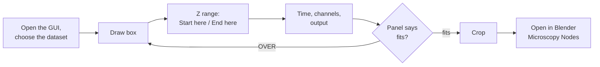
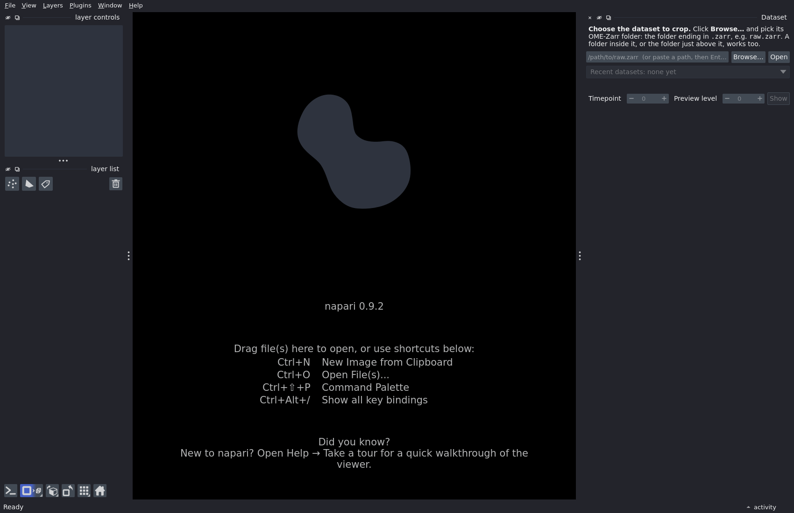
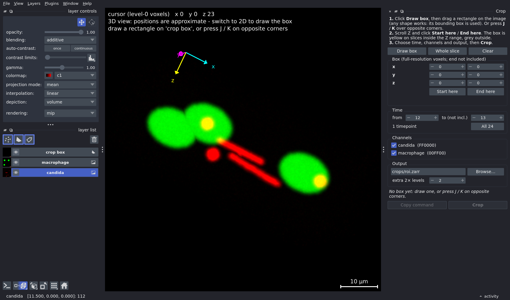
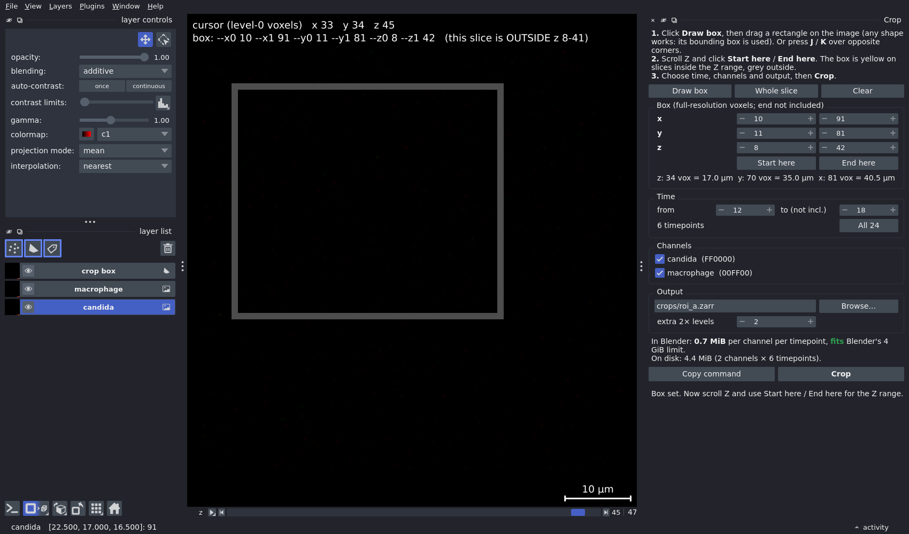
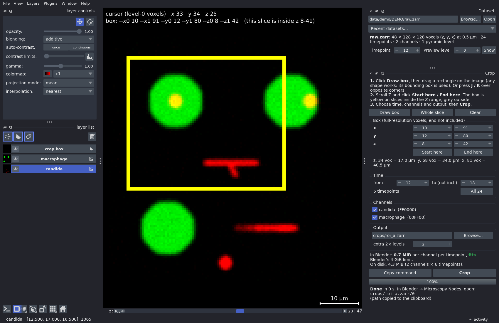
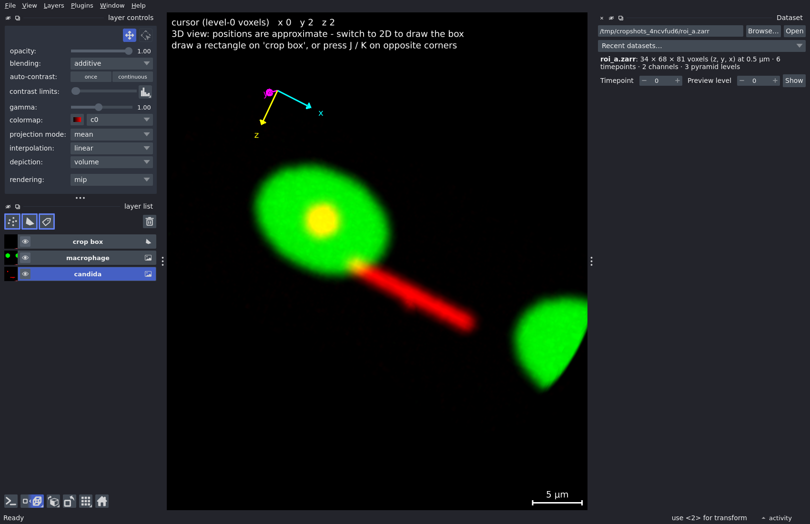

# 4 · Cropping & 3D rendering (optional)

<div class="mc-meta" markdown>
<span>**Runs on** CPU; the crop GUI needs a display</span>
<span>**Time** 5 min the first time, then about a minute per crop</span>
<span>**Use for** Blender / Microscopy Nodes renders, sharing a small example</span>
</div>

The full lattice light-sheet stack is too big to load into Blender. This stage lets you
**draw a box around an interesting region in napari, check that it will fit, and cut it out
at full resolution** as a small OME-Zarr that
[Microscopy Nodes](https://github.com/oanegros/MicroscopyNodes) opens directly.

The analysis stages don't need it, so skip it unless you want 3D renders or a shareable
excerpt.

## Two ways to crop

| | **Crop GUI** (recommended) | **Command line** |
|---|---|---|
| Start it with | `12_crop_roi.py --gui` | `12_crop_roi.py --x0 … --out …` |
| How you choose the box | Draw it on the image; Z with two buttons | Type level-0 voxel numbers |
| Needs a display? | Yes (a VNC / OpenOnDemand / Strudel desktop) | No: SSH, batch jobs, scripts |
| Size check | Live, in the panel | `--dry-run` |
| Writes | When you press **Crop** | When you run it (without `--dry-run`) |

Both write **the same files through the same code**. The GUI's **Copy command** button gives
you the command-line version of whatever you set up, for repeating a crop in a batch job.



## Before you start

- [ ] **A desktop session with a display**: a VNC, OpenOnDemand or Strudel desktop, or your
      own workstation. Over plain SSH, use the [command line](#crop-from-the-command-line).
- [ ] **The pixi environment installed** (`pixi install`; see [Installation](../getting-started/installation.md)).
      Commands below are run from the repository root with `pixi run python ...`.
- [ ] **The dataset as OME-Zarr**: a folder ending in `.zarr` (for example
      `full_stack/raw.zarr`) made by [stage 1, Conversion](01-conversion.md). CZI or TIFF
      files need converting first. In the GUI you **choose it in napari**; you don't need to
      know the path in advance. The command line takes it as `--store PATH`, or from a
      variable set once per shell (the default is `full_stack/raw.zarr` in the repository):

    ```bash
    export CANMAC_FULLSTACK_ZARR=/path/to/full_stack/raw.zarr
    ```

    Relative `--store` and output paths are taken relative to **the directory you run the
    command from**.

!!! tip "Practise on the demo store first"
    The [synthetic demo](../getting-started/demo.md) store is tiny (128 × 128 × 48 voxels,
    24 timepoints) and opens instantly. Generate it once with `pixi run demo`, or with
    `python -m canmac.demo generate`, then choose `data/demo` in the GUI (or add
    `--store data/demo/DEMO/raw.zarr` to the commands on this page). Everything works the
    same way as on the real data. The screenshots below are from the demo.

## Crop in napari

### 1. Open the crop GUI and choose your dataset

```bash
pixi run python scripts/cropping/12_crop_roi.py --gui
```

napari opens with a **Dataset** panel on the right. Tell it which dataset to crop, in any of
these ways:

- Click **Browse…** and pick the dataset's `.zarr` folder.
- Paste a path into the box and press ++enter++ (or **Open**).
- Choose one from **Recent datasets**: the GUI remembers the last eight you opened.

<figure markdown="span">
  { loading=lazy }
  <figcaption>Started without a dataset: choose one in the Dataset panel.</figcaption>
</figure>

You don't have to hit the `.zarr` folder exactly. A folder **inside** it (`raw.zarr/0`)
works, and so does the folder **just above** it if that holds only one dataset: picking
`data/demo` opens `data/demo/DEMO/raw.zarr`. If the choice can't be opened, the panel says
why in red (a single CZI file, a folder with several datasets in it, …) and you can simply
choose again. See [troubleshooting](#troubleshooting).

!!! tip "Skip the choosing"
    If you already know the path, give it on the command line and the dataset opens straight
    away: `12_crop_roi.py --gui --store /path/to/raw.zarr` (or `--store data/demo` to
    practise). With `CANMAC_FULLSTACK_ZARR` set, or a `full_stack/raw.zarr` in the
    repository, that opens without `--store` too.

Once it's open, the panel shows the dataset's size, voxel size, number of timepoints and
channels. It shows timepoint 0 at a coarse pyramid level, which is fast to look around in.
Only the planes on screen are read, never the whole dataset. You get one layer per channel
(*Candida* red, macrophages green), an empty **crop box** layer, and the **Crop** panel
below the Dataset panel. The view is **2D**, one Z slice at a time; move through Z with the
slider under the image.

To look at another **timepoint** or **preview level**, change it in the Dataset panel and
click **Show**. Your box stays where it is. Opening a **different dataset** starts with a
fresh box, as its coordinates mean something else.

<figure markdown="span">
  { loading=lazy }
  <figcaption>The crop GUI with a box drawn. <b>Left:</b> layers; the <code>crop box</code>
  layer holds your rectangle. <b>Middle:</b> the image; the overlay (top-left) shows the cursor
  and the box in full-resolution voxels. <b>Right:</b> the Dataset panel (which dataset,
  timepoint and preview level) and the Crop panel.</figcaption>
</figure>

To look at the whole volume in 3D first, click the **2D/3D** button (bottom-left) or start
with `--3d`. This needs working OpenGL; if napari crashes, see
[the segfault entry](#troubleshooting). Switch back to 2D to draw the box.

<figure markdown="span">
  { loading=lazy }
  <figcaption>The 3D view, for getting your bearings. Boxes are drawn in 2D.</figcaption>
</figure>

### 2. Draw the box

1. Click **Draw box** in the panel.
2. Drag a rectangle over the region you want on the image.

That sets X and Y. Some details:

- **Any shape works.** The rectangle, ellipse and polygon tools in the layer controls all set
  the box to the shape's bounding box, because a crop is always a box. The shape is then
  tidied into a rectangle.
- **Drawing again replaces the box.** To fine-tune it, type into the **x** / **y** start and
  end boxes; the rectangle follows.
- **Whole slice** sets the full X/Y extent. **Clear** removes the box.
- **Keyboard alternative:** hover over one corner and press ++j++, then over the opposite
  corner and press ++k++. This sets Z as well, from the two slices you pressed them on.

The rectangle is the same on every Z slice: it marks X and Y only.

### 3. Set the Z range

Scroll to the first slice you want and click **Start here**. Scroll to the last slice you
want and click **End here**. That slice is included. You can also type into the **z** boxes.

The rectangle is **yellow on slices inside the Z range and grey outside it**. Scrolling
through Z shows you the box's full 3D extent. The overlay also says whether the current
slice is inside.

<figure markdown="span">
  { loading=lazy }
  <figcaption>Slice 45 is above the Z range (8–41), so the box is grey here.</figcaption>
</figure>

### 4. Choose time and channels

- **Time:** **from** is the first timepoint, and **to (not incl.)** is one past the last.
  `12` → `18` gives 6 timepoints. **All N** takes the whole movie. Microscopy Nodes loads a
  multi-timepoint crop as a sequence.
- **Channels:** untick any you don't need. The lysed-cell channel is never offered unless
  you started the GUI with `--include-lysed`.

Cells move. Check the box still covers what you care about at other timepoints: set
**Timepoint** in the Dataset panel and click **Show**. The box stays put while you look.

### 5. Check the size

The panel shows, live, how big each volume will be in Blender:

> In Blender: **0.7 MiB** per channel per timepoint, **fits** Blender's 4 GiB limit.

Microscopy Nodes turns each channel at each timepoint into a 32-bit float volume, and
Blender's viewport and EEVEE renderer cannot show a single volume over **about 4 GiB**
([blender#136263](https://projects.blender.org/blender/blender/issues/136263)). The limit is
per volume, so many timepoints or channels are fine as long as each one fits. If the panel
says **OVER**, shrink the box (Z is often the easiest to give up), or render with **Cycles**,
which has no such limit but is slower.

Rough limits for a square XY box at the reference voxel size (0.145 µm):

| Z slices in box | Largest square XY box that fits |
|---:|---|
| 301 (full depth) | 1888 × 1888 voxels (≈ 274 µm) |
| 200 | 2317 × 2317 (≈ 336 µm) |
| 150 | 2675 × 2675 (≈ 388 µm) |
| 100 | 3276 × 3276 (≈ 475 µm) |
| 64 | 4096 × 4096 (≈ 594 µm) |
| cube | 1024 × 1024 × 1024 (≈ 148 µm) |

### 6. Crop

The **Output** name fills itself in from the box and time range, for example
`crops/roi_x10-90_y12-80_z8-42_t12-18.zarr`, so the file name records where it came from.
Type your own name or use **Browse…** if you prefer.

Press **Crop**. A progress bar shows the write, and you can keep using the viewer meanwhile.
The crop is always taken at **full resolution**, whatever level you are viewing. When it
finishes, the panel shows the path to give Microscopy Nodes and copies it to the clipboard.

<figure markdown="span">
  { loading=lazy }
  <figcaption>Done. Paste the copied <code>…/roi_a.zarr/0</code> path into Microscopy Nodes.</figcaption>
</figure>

The panel asks before **replacing** an existing output, and before writing a crop that is
**over** Blender's limit.

### 7. Check the result and open it in Blender

To look at it in the crop GUI, paste its path into the Dataset panel (it is on the
clipboard) and press ++enter++. Or open it on its own, in 3D at full resolution:

```bash
pixi run python scripts/cropping/11_preview_crop.py 0 --store crops/roi_a.zarr --level 0 --3d --no-panel
```

<figure markdown="span">
  { loading=lazy }
  <figcaption>The crop on its own. Coordinates restart at 0 inside a crop. Here the box clips
  the right-hand macrophage; draw it wider if you want all of it.</figcaption>
</figure>

In Blender: **Microscopy Nodes** panel → file path → the `.../roi_a.zarr/0` path.

### Getting around in napari

| To… | Do this |
|---|---|
| Pan / zoom | Drag / scroll on the image (with an image layer selected, not the crop box) |
| Move through Z | The slider under the image |
| 2D ↔ 3D | The **2D/3D** button (bottom-left), or ++ctrl+y++ |
| See dim structures | Select a channel layer, then lower the **contrast limits** or **gamma** (top-left) |
| Hide a channel or the box | The eye icon next to the layer |
| Stop drawing | Select a channel layer in the layer list |
| Read a position | The overlay (top-left of the image), in full-resolution voxels. Not the status bar at the bottom: that shows pixel indices of the downsampled preview |

!!! warning "Why J and K, not 1 and 2?"
    napari reserves ++1++ / ++2++ for an image layer's *pan/zoom* and *transform* modes. In
    transform mode, dragging **moves the layer**, which would shift every coordinate. If the
    image ever jumps when you drag, press ++1++.

!!! abstract "Coordinates are always full-resolution voxels"
    Every box number, in the panel, the overlay and the command line, is a
    **full-resolution (level-0) voxel index**, whatever level you view at. Starts are included
    and ends are **excluded**, like Python slicing: x `100` → `300` is 200 voxels wide.

## Crop from the command line

Use this over SSH, in batch jobs, or to repeat a crop exactly. The easiest way to get the
command is to set the crop up in the GUI and press **Copy command**. You can also write it
yourself:

```bash
# dry run first: prints sizes, writes nothing
pixi run python scripts/cropping/12_crop_roi.py \
    --x0 10 --x1 90 --y0 12 --y1 80 --z0 8 --z1 42 \
    --out crops/roi_a.zarr --dry-run
```

```text
t      : [0:1]  (1 timepoint(s))
channel: 1:candida(FF0000), 2:macrophage(00FF00)
...
cropping from level 0: 34 x 68 x 80 (z,y,x)  voxel (0.5, 0.5, 0.5) um
  as float32 VDB, per channel per timepoint : 0.00 GiB (fits)     # must say "fits"
  uint16 on disk, all channels/timepoints   : 0.00 GiB            # disk space needed
```

If it says `fits`, run the same command without `--dry-run`. The cropper prints progress
every 10 %.

=== "One timepoint"

    ```bash
    pixi run python scripts/cropping/12_crop_roi.py \
        --x0 10 --x1 90 --y0 12 --y1 80 --t0 12 --out crops/roi_a_t12.zarr
    ```

=== "A stretch of timelapse"

    ```bash
    # timepoints 0..19 (t1 is exclusive); Microscopy Nodes loads this as a sequence
    pixi run python scripts/cropping/12_crop_roi.py \
        --x0 10 --x1 90 --y0 12 --y1 80 --t0 0 --t1 20 --out crops/roi_a.zarr
    ```

=== "One channel only"

    ```bash
    pixi run python scripts/cropping/12_crop_roi.py \
        --x0 10 --x1 90 --y0 12 --y1 80 --channels candida --out crops/roi_a_candida.zarr
    ```

For a quick size table without a window, use `11_preview_crop.py 0 --x0 … --check`.

## What gets written

```text
crops/roi_a.zarr/
├── .zattrs                  # bioformats2raw layout marker
└── 0/                       # <- give this path to Microscopy Nodes
    ├── .zattrs              # OME-NGFF 0.4 multiscales + channel names/colours + where it came from
    ├── 0/                   # full resolution, (T, C, Z, Y, X)
    ├── 1/                   # 2x smaller in Z, Y and X
    └── 2/                   # 4x smaller in Z, Y and X
```

- **Pixel values are copied unchanged** (uint16, no bleach correction or rescaling).
- **Coordinates restart at 0.** The first timepoint becomes `t = 0` and the box corner becomes
  voxel `(0, 0, 0)` in the crop. The original box and time range are stored in
  `0/.zattrs` under `multiscales[0].metadata.canmac_crop`, so you can always map back to the
  full stack.
- **Extra levels are isotropic.** The source pyramid only shrinks X and Y, but the crop's
  levels 1 and 2 shrink Z as well, so every level renders with cubic-ish voxels. They are
  handy for fast drafts in Blender. Set the number with **extra 2× levels** in the panel, or
  `--extra-levels` on the command line.
- **The lysed-cell channel (magenta, `FF00FF`) is left out** unless you ask for it with
  `--include-lysed`.
- It is standard OME-Zarr, so other OME-Zarr tools can read it too.

## Option reference

### `12_crop_roi.py --gui` / `11_preview_crop.py T`: the crop GUI

`12_crop_roi.py --gui` opens the same window as `11_preview_crop.py`. It passes on
`--store`, `--t0` (the timepoint shown first), `--level`, `--channels`, `--include-lysed`
and any box flags, which pre-fill the crop box. Everything is optional: with no options the
window opens and asks for the dataset.

| Option (`11_preview_crop.py`) | Default | Meaning |
|---|---|---|
| `T` | `0` | Timepoint to show first (0-based); the panel's time range starts here. Change it later in the Dataset panel |
| `--store PATH` | `$CANMAC_FULLSTACK_ZARR`, else `full_stack/raw.zarr` if it exists, else **ask in the window** | Dataset to open: the `.zarr` folder, a folder inside it, or the folder just above it |
| `--x0 --x1 --y0 --y1 --z0 --z1` | full extent | Load only this region (level-0 voxels), and pre-fill the crop box with it. Use it with `--level 0` for a sharper look at a small area |
| `--level N` | 2, or the coarsest level available | Pyramid level to *display*. Crops are always written at full resolution |
| `--channels` | `all` | Channels to show and offer in the panel (see below) |
| `--include-lysed` | off | Also show and offer the lysed-cell channel |
| `--3d` | off (opens in 2D) | Start in the 3D view. Needs working OpenGL (see [troubleshooting](#troubleshooting)) |
| `--no-panel` | off | View only, without the Crop panel |
| `--check` | off | Print the summary and size table only; no window |

`--channels` takes `all`, names, or indices, comma-separated. `candida,macrophage` match by
colour (`FF0000`, `00FF00`); `1,2` match by position in the store (the summary line
`channel: 1:candida(...)` shows them). If your store uses other colours, use indices.

### `12_crop_roi.py --out PATH`: command-line crop

| Option | Default | Meaning |
|---|---|---|
| `--out PATH` | required | Output `.zarr` folder |
| `--store PATH` | as above | Source OME-Zarr |
| `--x0 --x1 --y0 --y1 --z0 --z1` | full extent | Box in level-0 voxels; start included, end excluded |
| `--t0 N` | `0` | First timepoint |
| `--t1 N` | `t0 + 1` | Stop timepoint, **excluded** (`--t0 10 --t1 20` = 10 frames) |
| `--channels` | `all` | As above |
| `--include-lysed` | off | Also copy the lysed-cell channel |
| `--level N` | `0` | Source level to crop *from*. Leave at 0 to keep full resolution |
| `--extra-levels N` | `2` | Isotropic 2× downsampled levels to add |
| `--chunk-xy`, `--chunk-z` | `256`, `64` | Output chunk sizes |
| `--dry-run` | off | Report sizes, write nothing |
| `--overwrite` | off | Replace `--out` if it already exists |

## Troubleshooting

??? question "The Dataset panel says **Couldn't open it.**"
    The red message says what it found instead of a dataset. Choose again; nothing else needs
    restarting.

    - **`… is a single file`**: you picked a CZI / TIFF / other file. The cropper reads the
      OME-Zarr *folder* that [Conversion](01-conversion.md) writes. Convert first, then pick
      the `.zarr` folder.
    - **`No OME-Zarr dataset found in …`**: that folder has no dataset in it or directly
      below it. Pick the folder ending in `.zarr` (it contains a folder called `0`).
    - **`… holds 3 datasets (ROI2/raw.zarr, …). Choose one of them.`**: you picked a folder
      above several datasets. Go one level further down.
    - **`… does not exist`**: check the path. A relative path is taken from the folder you
      started the command in.
    - **`… without the bioformats2raw '0/' level`**: an OME-Zarr image written by another
      tool. Re-convert it with [Conversion](01-conversion.md).
    - **`Timepoint 30 doesn't exist`** / **`Preview level 3 doesn't exist`**: pick one within
      the range in the info line.

??? failure "`Error drawing visual <Volume …>` then `Segmentation fault (core dumped)`"
    napari's 3D view needs OpenGL that can render 3D textures, and the remote desktop's
    graphics stack can't. This is common on VNC/Strudel/OpenOnDemand desktops that aren't
    routed through the GPU. The data and the script are fine. In order of preference:

    1. **Stay in 2D.** The GUI opens in 2D, and drawing and cropping only need 2D. Just
       don't press the 2D/3D button or pass `--3d`.
    2. **On a GPU desktop, use VirtualGL:**
       `vglrun pixi run python scripts/cropping/12_crop_roi.py --gui`
    3. **Anywhere, use Mesa's software renderer** (slower; fine for a coarse level or a small box):
       `LIBGL_ALWAYS_SOFTWARE=1 pixi run python scripts/cropping/12_crop_roi.py --gui`

    To see what you have, run `glxinfo -B | grep -iE "renderer|version"`. A renderer of
    `llvmpipe` means software rendering, which works but slowly. An OpenGL version below 3,
    or an error, means 3D won't work without option 2 or 3.

??? failure "`qt.qpa.xcb: could not connect to display` / `Could not load the Qt platform plugin`"
    There is no display: you are on a plain SSH session or a compute node. Open a VNC or
    OpenOnDemand desktop and run it from a terminal there, or use the
    [command line](#crop-from-the-command-line), which needs no display.

??? question "The **Crop** button is greyed out"
    There is no box yet (draw one, or press J / K), or no channel is ticked, or a crop is
    already running.

??? question "Drawing doesn't start / dragging pans the image instead"
    Click **Draw box** first: it selects the `crop box` layer in rectangle mode. Dragging with
    a channel layer selected pans the view.

??? question "The panel says **Crop failed:** …"
    The message is the actual error, for example a full disk or a read-only output folder.
    Fix that and press **Crop** again; any half-written output is replaced (the panel asks
    first).

??? warning "**OVER** Blender's 4 GiB limit"
    A single channel at a single timepoint is too big for Blender's viewport/EEVEE. Shrink
    the box (Z depth is often the easiest to give up; see the [sizing table](#5-check-the-size)),
    or render with **Cycles**, which does not have this limit but is slower.

??? question "The preview is very slow"
    A large region at `--level 0` reads a lot of data. Look around at the default coarse
    level and draw the box there; the crop is written at full resolution anyway. Hide
    channels you don't need.

??? question "The overlay numbers don't match the status bar"
    Expected. The status bar shows pixel indices of the displayed (downsampled, offset)
    layer. The overlay and the panel use full-resolution voxels.

??? question "Pressing J / K does nothing"
    The keys go to whichever part of the window has keyboard focus. Click once on the image
    and try again. Nothing is picked unless the mouse is over the image.

??? question "The image jumped / moves when I drag"
    A channel layer is in *transform* mode (napari's ++2++ shortcut). Press ++1++, or click
    the four-arrow pan/zoom icon at the top of the layer controls. Then close and re-open the
    GUI so no layer is left shifted.

??? failure "Command line: `ERROR: …` messages"
    - `--level 2 but only 1 levels exist`: use a smaller `--level`, or leave it out.
    - `empty range on x: [50:50]`: end equals start. Ends are excluded, so a 1-voxel box
      is `--x0 50 --x1 51`.
    - `! x: [100:999] clamped to [100:128]`: not an error; the box was trimmed to the volume.
    - `channel(s) [0] are the lysed channel`: add `--include-lysed` if you really want it.
    - `crops/roi_a.zarr exists`: choose a new `--out`, or add `--overwrite`.
    - `bad timepoint range [40:40] for T=120`: `--t1` must be larger than `--t0` and at most T.

## FAQ

**Why crop instead of downsampling the whole stack?**
Downsampling throws away detail everywhere. Cropping keeps full resolution where it
matters and is the only way to stay under Blender's per-volume limit at native resolution.

**Can I crop several regions?**
Yes. In the GUI, draw the next box and press **Crop** again; the output name follows the
new box. Each crop records its source box in its metadata.

**Can I crop a non-rectangular region?**
The crop is always a box (OME-Zarr arrays are boxes). Drawing an ellipse or polygon uses
its bounding box.

**Does cropping affect the analysis results?**
No. The analysis stages always read the original dataset stores; crops are only for
visualisation and sharing.

**Can I crop from the per-ROI datasets (ROI2, ROI7) instead of the full stack?**
Yes. Choose that dataset's `raw.zarr` in the Dataset panel, or pass it as `--store`. Any
OME-Zarr in the bioformats2raw layout
(a folder containing `0/` with `t, c, z, y, x` axes) works, including a crop you made earlier.
