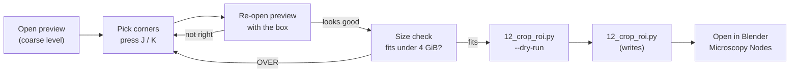
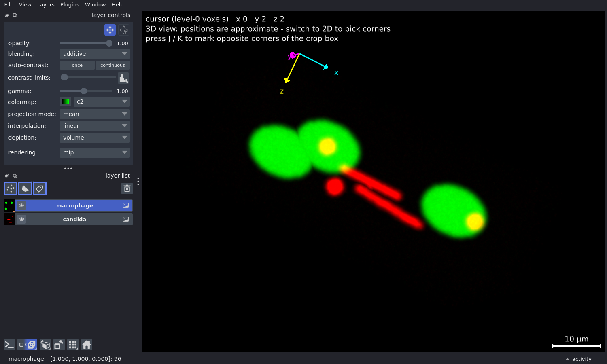
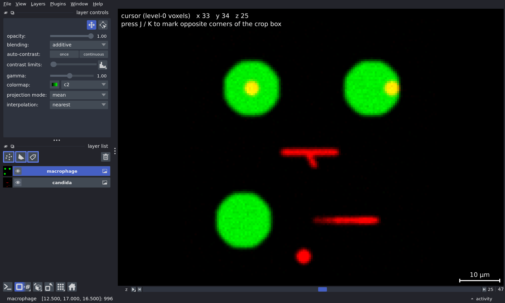
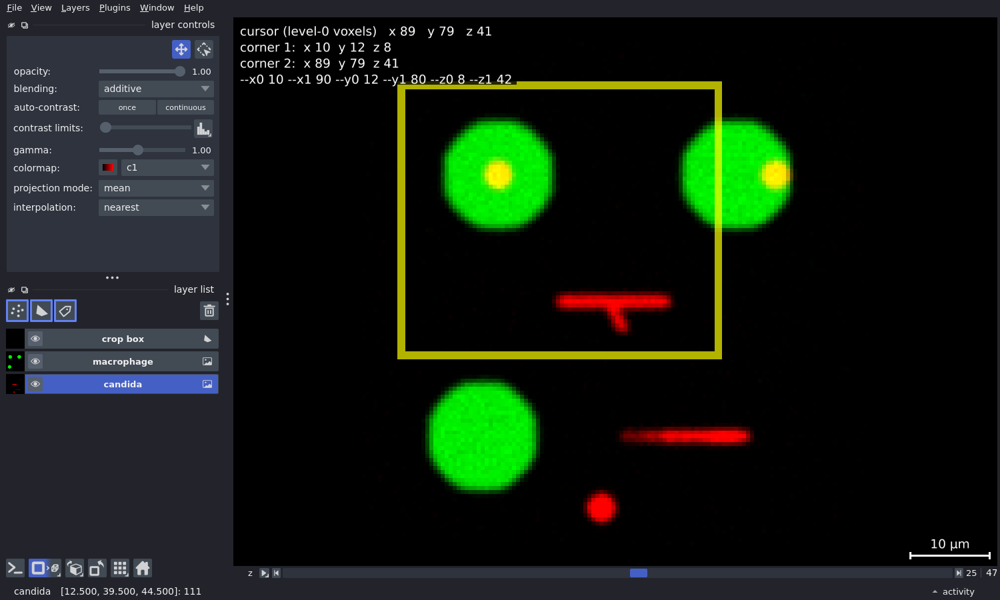
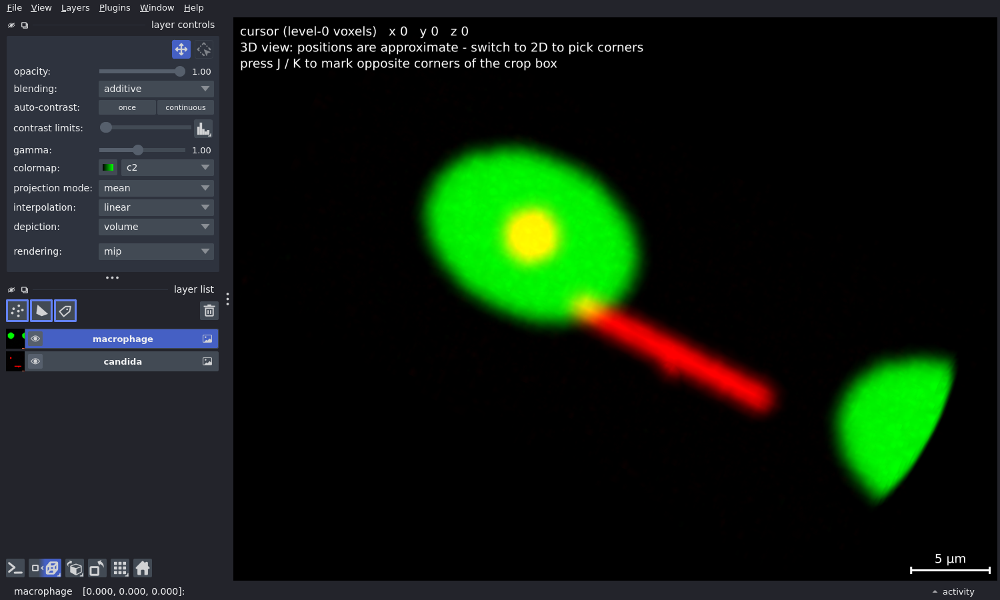

# 4 · Cropping & 3D rendering (optional)

<div class="mc-meta" markdown>
<span>**Runs on** CPU; the preview needs a display</span>
<span>**Time** 10–20 min the first time, then minutes</span>
<span>**Use for** Blender / Microscopy Nodes renders, sharing a small example</span>
</div>

The full lattice light-sheet stack is too big to load into Blender. This stage helps you
**find an interesting region in napari, check that it will fit, and cut it out at full
resolution** as a small OME-Zarr that
[Microscopy Nodes](https://github.com/oanegros/MicroscopyNodes) opens directly.

The analysis stages don't need it, so skip it unless you want 3D renders or a shareable
excerpt.

## The two tools at a glance

| | `11_preview_crop.py`: **look** | `12_crop_roi.py`: **cut** |
|---|---|---|
| What it does | Opens one timepoint of a box in napari | Copies a box (and optionally a range of timepoints) to a new OME-Zarr |
| Writes to disk? | **Never** | Yes, to `--out` |
| Needs a display? | Yes (or `--check` for text only) | No; runs anywhere, including over SSH or in a batch job |
| Speed | Fast: shows a downsampled level, loads lazily | Reads full-resolution data |
| Coordinates | Level-0 voxels | Level-0 voxels: **the same numbers** |



!!! abstract "The one rule to remember"
    Every `--x0/--x1/--y0/--y1/--z0/--z1` number, in both scripts, is a **full-resolution
    (level-0) voxel index**. Preview at whatever level you like; the box is rescaled for you,
    so the numbers you settle on in the preview mean exactly the same thing to the cropper.
    Starts (`x0`) are included and stops (`x1`) are **excluded**, like Python slicing:
    `--x0 100 --x1 300` is 200 voxels wide.

## Before you start

- [ ] **A desktop session with a display** for the preview: a VNC or OpenOnDemand desktop, or
      your own workstation. Over plain SSH, use `--check` (text only) and the cropper, which
      need no display.
- [ ] **The pixi environment installed** (`pixi install`; see [Installation](../getting-started/installation.md)).
      Commands below are run from the repository root with `pixi run python ...`.
- [ ] **The source store.** The default is `full_stack/raw.zarr` in the repository. Point to
      another store with `--store PATH`, or set it once per shell:

    ```bash
    export CANMAC_FULLSTACK_ZARR=/path/to/full_stack/raw.zarr
    ```

    Relative `--store` and `--out` paths are taken relative to **the directory you run the
    command from**.

!!! tip "Practise on the demo store first"
    The [synthetic demo](../getting-started/demo.md) store is tiny (128 × 128 × 48 voxels,
    24 timepoints) and opens instantly. Generate it once with `pixi run demo`, or with
    `python -m canmac.demo generate`, then add `--store data/demo/DEMO/raw.zarr` to every
    command on this page. Its numbers are smaller than the real data, but everything works
    the same way.

## Step-by-step

### 1. Open the whole volume

```bash
pixi run python scripts/cropping/11_preview_crop.py 0
```

`0` is the timepoint. With no box flags you get the whole volume at a coarse pyramid level
(level 2, or the coarsest available), which is fast enough to look around in. A napari window
opens with one layer per channel (*Candida* in red, macrophages in green) shown as a maximum
intensity projection in 3D.

<figure markdown="span">
  { loading=lazy }
  <figcaption>What opens: layer controls (top-left panel), one layer per channel (layer list),
  and the <b>cursor overlay</b> (top-left of the canvas) that reports positions in level-0
  voxels. In 3D it reminds you to switch to 2D before picking corners.</figcaption>
</figure>

The terminal shows a summary first. This is real output from the demo store:

```text
store  : .../data/demo/DEMO/raw.zarr
axes   : tczyx   levels: 1   level 0: (24, 3, 48, 128, 128)    # (T, C, Z, Y, X) at full res
t      : 5 of 24
channel: 1:candida(FF0000), 2:macrophage(00FF00)               # lysed channel 0 skipped

ROI box (level-0 voxels):                                      # <- the numbers the cropper uses
  x: [20:120]  100 vox  50.0 um
  y: [10:60]  50 vox  25.0 um
  z: [0:48]  48 vox  24.0 um

this ROI as a float32 VDB (per channel, per timepoint):
  level      z     y      x      GiB  vs Blender 4 GiB
      0     48    50    100     0.00  fits            <-- previewing

  2 channel(s) -> 2 separate volume objects in Microscopy Nodes
```

On the real stack the size table has one row per pyramid level. Look at the **level 0** row:
that is the size of what the cropper will write.

### 2. Find your region and pick the corners

Getting around in napari:

| To… | Do this |
|---|---|
| Rotate / pan / zoom in 3D | Left-drag / ++shift++ + drag / scroll |
| Switch between 3D and 2D slices | The **2D/3D** button (bottom-left, square/cube icon), or ++ctrl+y++ |
| Move through Z in 2D | The slider under the canvas |
| See dim structures | Select a layer, then drag **contrast limits** down or lower **gamma** (layer controls, top-left) |
| Hide a channel | The eye icon next to the layer |
| Show a single slice in 3D | Layer controls → **rendering** `mip` → `attenuated_mip` or `translucent` |

Reading positions:

- The **overlay in the top-left corner** shows the cursor position in **level-0 voxels**, so
  you can read crop numbers straight off it.
- Ignore napari's own status bar at the bottom. It shows pixel indices of the *previewed*
  layer (downsampled and offset by the box), which are not the numbers the cropper wants.

<figure markdown="span">
  { loading=lazy }
  <figcaption>2D mode: one Z slice at a time, chosen with the <b>z slider</b> under the canvas.
  The overlay shows the voxel under the mouse (here x 33, y 34 on slice z 25).</figcaption>
</figure>

To pick a box:

1. Switch to **2D** (in 3D, the cursor depth is ambiguous and the overlay warns you).
2. Scroll to a Z slice at one end of the region and hover over one corner. Press ++j++.
3. Scroll to the other end in Z, hover over the opposite corner and press ++k++.
4. A **yellow rectangle** shows the box in X/Y on every slice, the overlay lists both corners
   and the flags, and the terminal prints the flags ready to copy:

    ```text
    corner 1: x 10  y 12  z 8   (level-0 voxels)
    corner 2: x 89  y 79  z 41   (level-0 voxels)

    crop box flags:
      --x0 10 --x1 90 --y0 12 --y1 80 --z0 8 --z1 42
    ```

    The corners can be picked in any order. The stop values are one past the corner you
    marked, so the corner voxels are inside the box. Press ++j++ or ++k++ again to re-pick
    a corner; the rectangle follows.

<figure markdown="span">
  { loading=lazy }
  <figcaption>After ++j++ on (x 10, y 12, z 8) and ++k++ on (x 89, y 79, z 41): the box is
  drawn in yellow (its own <code>crop box</code> layer; hide it with the eye icon), and the last
  overlay line is exactly what to paste into the next command.</figcaption>
</figure>

!!! warning "Why J and K, not 1 and 2?"
    napari reserves ++1++ / ++2++ for an image layer's *pan/zoom* and *transform* modes. In
    transform mode, dragging **moves the layer**, which would shift every coordinate you read.
    If the layer-controls tool icons (top of the panel) show the transform tool selected,
    press ++1++ to return to pan/zoom.

!!! tip "Want the full depth?"
    Pick both corners on the same Z slice and then delete `--z0`/`--z1` from the flags.
    Omitted bounds default to the full extent of that axis.

### 3. Confirm the box

Close the viewer and re-open it with the flags you just copied:

```bash
pixi run python scripts/cropping/11_preview_crop.py 0 --x0 10 --x1 90 --y0 12 --y1 80 --z0 8 --z1 42
```

Now only the box is loaded, so you can afford a finer level. Try `--level 1`, or
`--level 0` for full resolution when the box is small. The box stays in its true
position in the volume, so the overlay still reads level-0 voxels. Repeat steps 2–3 until
the region looks right.

<figure markdown="span">
  { loading=lazy }
  <figcaption>The same box re-opened at <code>--level 0</code>: only the region you will crop
  is loaded. Here the box clips the right-hand macrophage. Widen <code>--x1</code> if you
  want all of it.</figcaption>
</figure>

Check another timepoint too (change `0` to, say, `20`). Cells move, so make sure the box
still covers what you care about over the time range you plan to crop.

### 4. Check that it fits in Blender

Read the **level 0** row of the size table, or run the size check without opening a window:

```bash
pixi run python scripts/cropping/11_preview_crop.py 0 --x0 10 --x1 90 --y0 12 --y1 80 --check
```

Microscopy Nodes turns each channel at each timepoint into a 32-bit float volume, and
Blender's viewport and EEVEE renderer cannot show a single volume over **about 4 GiB**
([blender#136263](https://projects.blender.org/blender/blender/issues/136263)). The whole
level-0 reference stack is 11.6 GiB per channel, so it does not fit in one piece.

Rough limits for a square XY box at the reference voxel size (0.145 µm):

| Z slices in box | Largest square XY box that fits |
|---:|---|
| 301 (full depth) | 1888 × 1888 voxels (≈ 274 µm) |
| 200 | 2317 × 2317 (≈ 336 µm) |
| 150 | 2675 × 2675 (≈ 388 µm) |
| 100 | 3276 × 3276 (≈ 475 µm) |
| 64 | 4096 × 4096 (≈ 594 µm) |
| cube | 1024 × 1024 × 1024 (≈ 148 µm) |

The limit is per channel and per timepoint, so cropping 40 timepoints of two channels is
fine as long as each single volume fits.

### 5. Dry run, then crop

Hand the **same flags** to the cropper, with an output path. Start with `--dry-run`, which
prints sizes and writes nothing:

```bash
pixi run python scripts/cropping/12_crop_roi.py \
    --x0 10 --x1 90 --y0 12 --y1 80 --z0 8 --z1 42 \
    --out crops/roi_a.zarr --dry-run
```

```text
t      : [0:1]  (1 timepoint(s))
channel: 1:candida(FF0000), 2:macrophage(00FF00)
...
cropping from level 0: 34 x 68 x 80 (z,y,x)  voxel (0.5, 0.5, 0.5) um
  as float32 VDB, per channel per timepoint : 0.00 GiB (fits)     # must say "fits"
  uint16 on disk, all channels/timepoints   : 0.00 GiB            # disk space needed
```

If it says `fits`, run the same command without `--dry-run`. Choose the timepoints and
channels at this stage:

=== "One timepoint"

    ```bash
    pixi run python scripts/cropping/12_crop_roi.py \
        --x0 10 --x1 90 --y0 12 --y1 80 --t0 12 --out crops/roi_a_t12.zarr
    ```

=== "A stretch of timelapse"

    ```bash
    # timepoints 0..19 (t1 is exclusive); Microscopy Nodes loads this as a sequence
    pixi run python scripts/cropping/12_crop_roi.py \
        --x0 10 --x1 90 --y0 12 --y1 80 --t0 0 --t1 20 --out crops/roi_a.zarr
    ```

=== "One channel only"

    ```bash
    pixi run python scripts/cropping/12_crop_roi.py \
        --x0 10 --x1 90 --y0 12 --y1 80 --channels candida --out crops/roi_a_candida.zarr
    ```

The cropper needs no display, so long crops can run over SSH or in a batch job.

### 6. Check the result and open it in Blender

When it finishes, the cropper prints the path to give Microscopy Nodes and a command to
check the crop in napari:

```bash
pixi run python scripts/cropping/11_preview_crop.py 0 --store crops/roi_a.zarr --level 0
```

In Blender: **Microscopy Nodes** panel → file path → the printed `.../roi_a.zarr/0` path.

## What gets written

```text
crops/roi_a.zarr/
├── .zattrs                  # bioformats2raw layout marker
└── 0/                       # <- give this path to Microscopy Nodes
    ├── .zattrs              # OME-NGFF 0.4 multiscales + channel names/colours
    ├── 0/                   # full resolution, (T, C, Z, Y, X)
    ├── 1/                   # 2x smaller in Z, Y and X
    └── 2/                   # 4x smaller in Z, Y and X
```

- **Pixel values are copied unchanged** (uint16, no bleach correction or rescaling).
- **Coordinates restart at 0.** Timepoint `--t0` becomes `t = 0` and the box corner becomes
  voxel `(0, 0, 0)` in the crop. Note the original offsets (the flags you used) if you need to
  map back to the full stack.
- **Extra levels are isotropic.** The source pyramid only shrinks X and Y, but the crop's
  levels 1 and 2 shrink Z as well, so every level renders with cubic-ish voxels. They are
  handy for fast drafts in Blender. Change the number of levels with `--extra-levels`.
- **The lysed-cell channel (magenta, `FF00FF`) is left out** unless you pass
  `--include-lysed`.
- Both are standard OME-Zarr, so other OME-Zarr tools can read them too.

## Choosing channels

`--channels` takes `all` (default), names, or indices, comma-separated:

| You write | You get |
|---|---|
| `all` | Every channel except the lysed one |
| `candida,macrophage` | Channels matched by colour: `candida` = `FF0000`, `macrophage` = `00FF00` |
| `1,2` | Channels by position in the store (the summary line `channel: 1:candida(...)` shows them) |

If your store uses different colours, the names won't resolve. Use indices instead, reading
them from the `channel:` line of the summary.

## Option reference

### `11_preview_crop.py T`: preview (writes nothing)

| Option | Default | Meaning |
|---|---|---|
| `T` | required | Timepoint to show (0-based) |
| `--store PATH` | `$CANMAC_FULLSTACK_ZARR`, else `full_stack/raw.zarr` | Source OME-Zarr (the folder containing `0/`) |
| `--x0 --x1 --y0 --y1 --z0 --z1` | full extent | Box in level-0 voxels; start included, stop excluded |
| `--level N` | 2, or the coarsest level available | Pyramid level to *display*. Doesn't change the meaning of the box |
| `--channels` | `all` | See [Choosing channels](#choosing-channels) |
| `--include-lysed` | off | Also show the lysed-cell channel |
| `--check` | off | Print the summary and size table only; no window |

In the viewer: ++j++ / ++k++ mark opposite corners (2D mode) and draw the box in yellow; the
top-left overlay shows the cursor in level-0 voxels.

### `12_crop_roi.py --out PATH`: crop (writes)

| Option | Default | Meaning |
|---|---|---|
| `--out PATH` | required | Output `.zarr` folder |
| `--store PATH` | as above | Source OME-Zarr |
| `--x0 --x1 --y0 --y1 --z0 --z1` | full extent | Box in level-0 voxels; same numbers as the preview |
| `--t0 N` | `0` | First timepoint |
| `--t1 N` | `t0 + 1` | Stop timepoint, **excluded** (`--t0 10 --t1 20` = 10 frames) |
| `--channels` | `all` | See [Choosing channels](#choosing-channels) |
| `--include-lysed` | off | Also copy the lysed-cell channel |
| `--level N` | `0` | Source level to crop *from*. Leave at 0 to keep full resolution |
| `--extra-levels N` | `2` | Isotropic 2× downsampled levels to add |
| `--chunk-xy`, `--chunk-z` | `256`, `64` | Output chunk sizes |
| `--dry-run` | off | Report sizes, write nothing |
| `--overwrite` | off | Replace `--out` if it already exists |

## Troubleshooting

??? failure "`qt.qpa.xcb: could not connect to display` / `Could not load the Qt platform plugin`"
    There is no display: you are on a plain SSH session or a compute node. Open a VNC or
    OpenOnDemand desktop and run it from a terminal there. To check sizes without a window,
    add `--check`. The cropper itself never needs a display.

??? failure "`ERROR: --level 2 but only 1 levels exist`"
    The store has fewer pyramid levels than you asked for. Use a smaller `--level`, or leave
    it out and the preview picks the coarsest available level.

??? failure "`ERROR: empty range on x: [50:50]`"
    The start and stop are equal (or the stop is smaller). Remember that stop is excluded:
    a 1-voxel-wide box is `--x0 50 --x1 51`.

??? warning "`! x: [100:999] clamped to [100:128]`"
    Not an error: the box ran past the edge of the volume and was trimmed to fit. Check the
    trimmed box is still what you want.

??? failure "`ERROR: channel(s) [0] are the lysed channel`"
    The lysed-cell channel is left out by default because the analysis ignores it. Add
    `--include-lysed` if you really want it.

??? failure "`ERROR: crops/roi_a.zarr exists (pass --overwrite to replace)`"
    The cropper won't silently replace earlier work. Choose a new `--out` or add `--overwrite`.

??? failure "`ERROR: bad timepoint range [40:40] for T=120`"
    `--t1` must be larger than `--t0` (it is excluded) and no larger than the number of
    timepoints.

??? warning "`OVER Blender 4 GiB by 1.6x`"
    A single channel at a single timepoint is too big for Blender's viewport/EEVEE. Shrink
    the box (Z depth is often the easiest to give up; see the [sizing table](#4-check-that-it-fits-in-blender)),
    or render with **Cycles**, which does not have this limit but is slower.

??? question "The preview is very slow"
    Level 0 of a big box reads a lot of data. Preview at a coarser `--level` (1 or 2) to pick
    the box, and use level 0 only to confirm a small box. Hide channels you don't need.

??? question "The overlay numbers don't match the status bar"
    Expected. The status bar shows pixel indices of the displayed (possibly downsampled,
    offset) layer. Use the overlay or the printed flags, which are level-0 voxels.

??? question "Pressing J / K does nothing"
    The keys go to whichever part of the window has keyboard focus. Click once on the
    canvas (the black image area) and try again; nothing is printed until the mouse is over
    the canvas. If the overlay doesn't mention J / K at all, you are running an older copy of
    `11_preview_crop.py`: update the repository.

??? question "The image jumped / moves when I drag"
    The layer is in *transform* mode (napari's ++2++ shortcut). Press ++1++ (or click the
    four-arrow pan/zoom icon at the top of the layer controls) to return to pan/zoom, then
    close and re-open the preview so no layer is left shifted.

## FAQ

**Why crop instead of downsampling the whole stack?**
Downsampling throws away detail everywhere. Cropping keeps full resolution where it
matters and is the only way to stay under Blender's per-volume limit at native resolution.

**Can I crop several regions?**
Yes: run the cropper once per region with a different `--out`. Note each region's flags (for
example in a text file next to the crops), since the crop itself starts its coordinates at 0.

**Does cropping affect the analysis results?**
No. The analysis stages always read the original dataset stores; crops are only for
visualisation and sharing.

**Can I crop from the per-ROI datasets (ROI2, ROI7) instead of the full stack?**
Yes. Pass that dataset's `raw.zarr` as `--store`. Any OME-Zarr in the bioformats2raw layout
(a folder containing `0/` with `t, c, z, y, x` axes) works, including a crop you made earlier.
