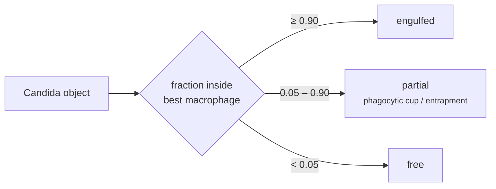

# 6 · Engulfment / entrapment

<div class="mc-meta" markdown>
<span>**Runs on** CPU · 8 cores · 64 GB</span>
<span>**Time** ~1 h</span>
<span>**Needs** Stage 5 labels for both channels</span>
</div>

## What it does

For every *Candida* object in every timepoint, it measures **what fraction of its voxels
lie inside each macrophage**, picks the best-overlapping macrophage, and assigns a class:



Macrophage masks from Cellpose are **filled** volumes, so a *Candida* object inside a
macrophage overlaps its label directly. No cavity handling is needed.

Timepoints missing either channel's labels are **skipped**, not failed, so you can run this
while segmentation is still in progress.

## Run it

```bash
sbatch --export=ALL,DATASET=ROI2 scripts/slurm/40_engulfment.sh
```

or directly:

```bash
pixi run python -m canmac.stages.engulfment --dataset ROI2 --all-t
pixi run python -m canmac.stages.engulfment --dataset ROI2 --finalize
```

### Tuning the rules

| Flag | Default | Meaning |
|---|---|---|
| `--engulf-frac` | `0.9` | Minimum fraction inside to count as `engulfed` |
| `--touch-frac` | `0.05` | Minimum fraction inside to count as `partial` |
| `--dilate N` | `0` | Grow each macrophage by N voxels first. Use it to tell membrane adhesion apart from internalisation. |
| `--candida-store` | – | Use an alternative *Candida* label store (e.g. micro-sam output) |

The review notebook includes a **threshold-sensitivity table** showing how class counts
shift as you move these values. Check it before you settle on numbers.

## What it writes

`results/{DATASET}/engulfment.csv`, one row per (timepoint, *Candida* object):

| Column | Meaning |
|---|---|
| `dataset`, `t` | Dataset id and timepoint index |
| `candida` | *Candida* label id **in this frame** (ids are not stable across frames) |
| `candida_vox` | Object size in voxels |
| `best_macrophage` | Label id of the macrophage with the largest overlap (0 = none) |
| `overlap_frac` | Fraction of the object inside that macrophage |
| `PROPOSED_class` | `engulfed`, `partial` or `free` |

Per-timepoint shards with counts per class are kept under `results/{DATASET}/engulfment/t{NNN}.json`.

## Check it

- [ ] Open `notebooks/05_engulfment_review.ipynb`: metrics over time, whole-frame renders,
      zoomed orthogonal views per event.
- [ ] Look at several `engulfed` and `partial` events in 3D:

    ```bash
    pixi run python viewers/view_engulfment.py --list            # timepoints ready to view
    pixi run python viewers/view_engulfment.py --t 41            # whole frame, coloured by class
    pixi run python viewers/view_engulfment.py --t 41 --candida 29   # crop to one pair
    ```

!!! warning "Per-frame geometry only"
    A real engulfment event should **persist** across consecutive frames. A one-frame overlap
    can be a transient contact or an artefact. Persistence and fate classification are
    not implemented yet. Until they are, count an event only when it holds for several
    frames in a row.
