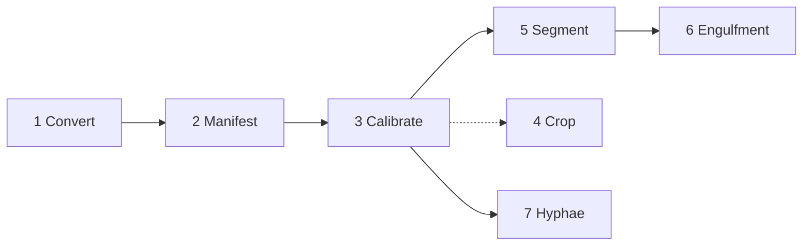

# Pipeline overview

Seven stages, each with the same layout on its page: **what it does**, **how to run it**,
**what it writes**, and **how to check it**.

| # | Stage | Runs on | Typical time (one ~30 GB dataset) | Required? |
|---|---|---|---|---|
| 1 | [Conversion](01-conversion.md): CZI → OME-Zarr | CPU, large memory | hours | yes |
| 2 | [Dataset manifest](02-manifest.md) | you, in a text editor | minutes | yes |
| 3 | [Calibration & bleaching](03-calibration.md) | CPU | tens of minutes | yes |
| 4 | [Cropping](04-cropping.md) | CPU | minutes | optional (for 3D rendering) |
| 5 | [3D segmentation](05-segmentation.md) | **GPU**, array of 120 tasks | hours (depends on queue) | yes |
| 6 | [Engulfment](06-engulfment.md) | CPU | ~1 h | for engulfment results |
| 7 | [Hyphal growth](07-hyphae.md) | **GPU**, one job | ~1–2 h | for growth results |

Stage 7 does not need stage 5: it builds its own 2D projections and segments them directly.

## Conventions shared by every stage

- **Run from the repository root**, after `source config.sh`. Stages use paths relative to
  the repo root.
- **Outputs go to `results/{DATASET}/`.** Most stages accept `--out-dir` to change this.
- **Re-running is safe.** Completed units are skipped.
- **Shards, then finalize.** Parallel work writes one small file per timepoint; a
  `--finalize` call combines them into one CSV.
- **Logs** go to `logs/<job-name>.<jobid>.log`.

For every flag of every command, see the [Command-line reference](../reference/cli.md).
